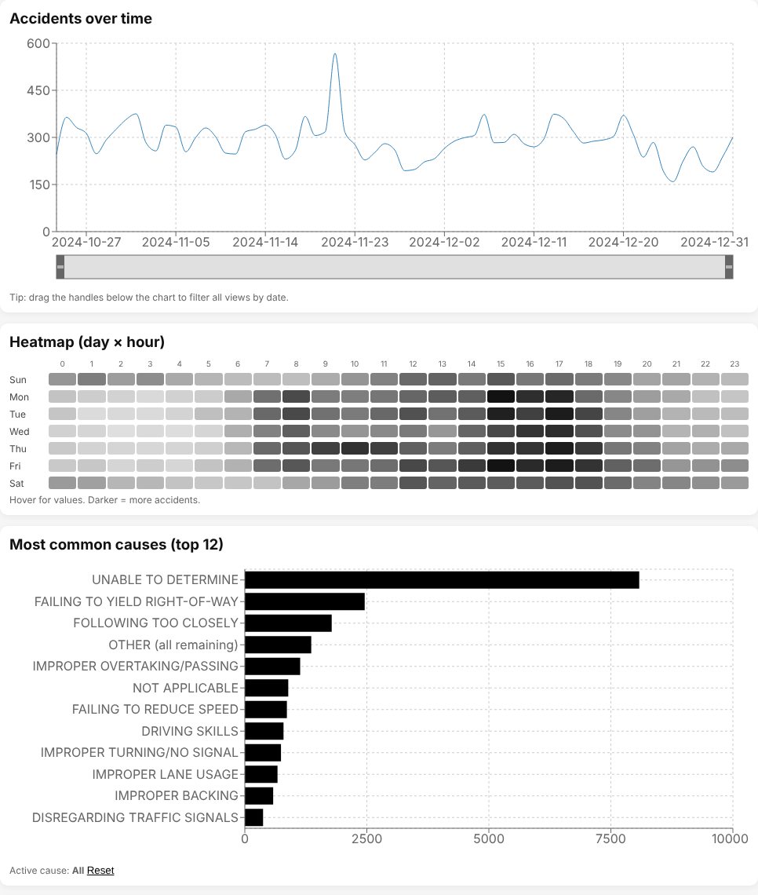
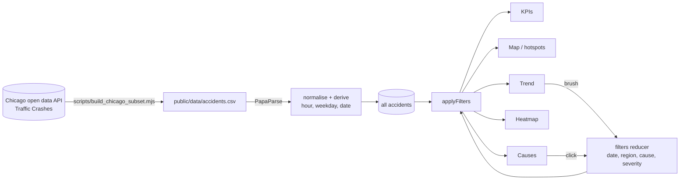

# Traffic Accidents and Risk Zones – Interactive Dashboard

An interactive React dashboard for exploring traffic accidents in space (map), time (trend and day × hour heatmap) and by cause and severity. All views are linked: a date range selected on the trend chart, a clicked cause or a severity filter updates the map, the charts and the key figures at once. A grid-based hotspot view highlights high-risk zones, weighted by accident severity.

The included data are 20,000 crashes from the City of Chicago open data portal (24 October – 31 December 2024).

**Stack:** React 19 · Vite · Leaflet + react-leaflet · Recharts · PapaParse · Node.js (data script)



<!-- TODO: add a screenshot of the full dashboard with the map, e.g. docs/dashboard.png -->

---

## Features

- **Key figures** for the current selection: number of accidents, most common known cause, riskiest hour.
- **Map** with one point per accident, or **hotspots**: accidents aggregated on a grid of adjustable cell size, with a risk score weighted by severity (light 1, serious 3, fatal 6).
- **Trend over time** (daily counts) with a brush to select a date range.
- **Heatmap** of accidents by weekday and hour.
- **Causes**: top-12 bar chart (click a bar to filter) and a searchable table with counts and shares.
- **Filters**: date range, region, cause and severity; all views are cross-filtered.
- **Export** of the filtered accidents as CSV.

## Architecture



- `src/lib/` – CSV loading (`dataLoaders`), normalisation and derived fields (`transforms`), aggregations: per day, day × hour matrix, causes, KPIs, grid hotspots (`aggregations`), CSV export.
- `src/state/` – filter state as a reducer (`filtersReducer`) and the filter function (`selectors`).
- `src/components/` – one folder per view (map, charts, filters, KPIs, causes table).

## Getting started

```bash
git clone https://github.com/antonela-kovic/traffic-accidents-dashboard.git
cd traffic-accidents-dashboard
npm install
npm run dev        # http://localhost:5173
```

Other scripts: `npm run build`, `npm run preview`, `npm run lint`.

### Refreshing the data

```bash
npm run data:chicago                              # 2024, 20,000 rows
npm run data:chicago -- --year 2023 --limit 30000
```

The script downloads crashes from the [City of Chicago Traffic Crashes dataset](https://data.cityofchicago.org/Transportation/Traffic-Crashes-Crashes/85ca-t3if), maps the most severe injury to `light` / `serious` / `fatal` / `unknown` and the primary contributory cause to `cause`, and writes `public/data/accidents.csv`. A full year has more than 20,000 crashes, so a larger `--limit` covers more of the year.

### Using your own data

Any CSV with these columns works (`public/data/accidents_sample.csv` is a small example):

| Column | Example |
|---|---|
| `id` | any unique value |
| `dateTime` | `2024-06-15T21:35:00` |
| `lat`, `lon` | `43.508`, `16.439` |
| `severity` | `light`, `serious`, `fatal` or `unknown` |
| `cause` | `speeding` |
| `region`, `city` | `Split-Dalmatia`, `Split` |

## Notes

- About 40 % of the Chicago records have the cause "UNABLE TO DETERMINE". The bar chart and the table show it, but the "most common known cause" figure skips such placeholder values.
- Points are drawn on a canvas so that 20,000 markers stay responsive; the hotspot view limits the map to the 300 highest-scoring cells.

## Data

City of Chicago, *Traffic Crashes – Crashes*, Chicago Data Portal. Map tiles © OpenStreetMap contributors.

## Author

Antonela Ković – [GitHub](https://github.com/antonela-kovic)
